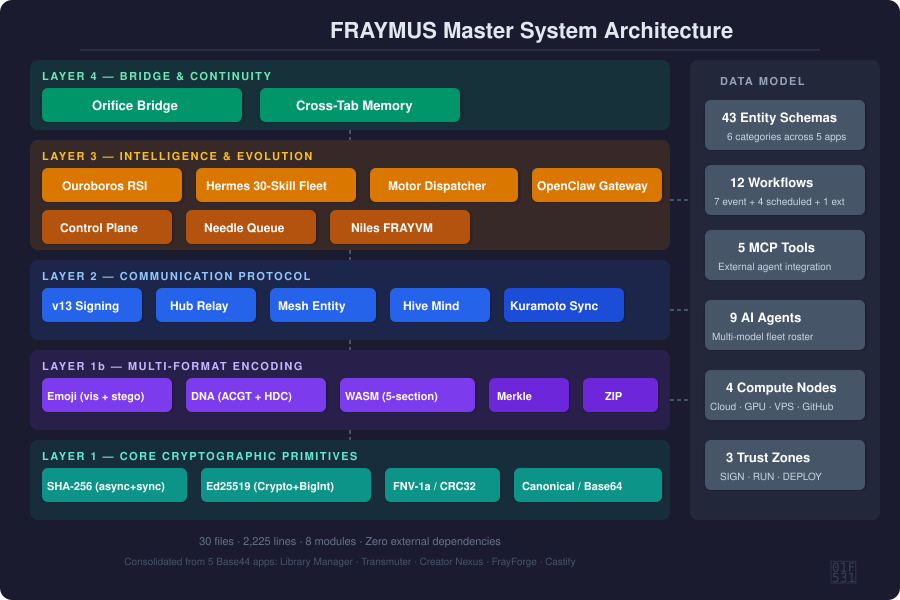
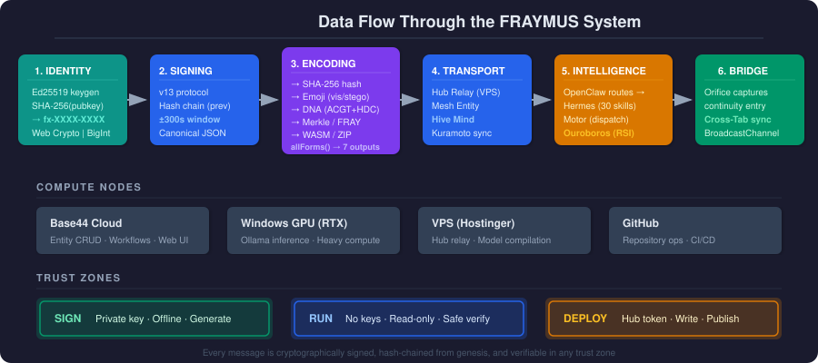
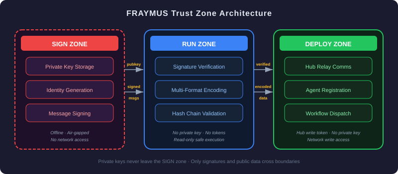
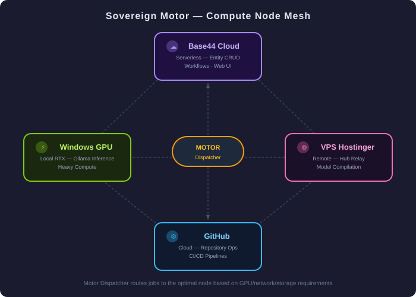

<div align="center">

# FRAYMUS Master System

### Sovereign Cryptographic Identity · Multi-Format Encoding · Autonomous Intelligence Fleet

[](#license)
[](https://nodejs.org)
[](#)
[](#project-structure)
[](#project-structure)

**A unified runtime that fuses cryptographic identity, seven-format data encoding, a signed mesh protocol, and an autonomous AI intelligence fleet into one importable package.**

*Consolidated from 5 production Base44 applications into a single, zero-dependency ESM codebase.*

</div>

---

## Table of Contents

- [What Is This?](#what-is-this)
- [Architecture Overview](#architecture-overview)
- [Core Concepts](#core-concepts)
  - [Cryptographic Identity (Ed25519)](#cryptographic-identity-ed25519)
  - [Multi-Format Encoding](#multi-format-encoding)
  - [v13 Signed Protocol](#v13-signed-protocol)
  - [Kuramoto Phase Synchronization](#kuramoto-phase-synchronization)
  - [Trust Zones](#trust-zones)
  - [Compute Node Mesh](#compute-node-mesh)
- [Module Reference](#module-reference)
  - [core/](#core)
  - [encoding/](#encoding)
  - [protocol/](#protocol)
  - [intelligence/](#intelligence)
  - [bridge/](#bridge)
  - [entities/](#entities)
  - [workflows/](#workflows)
  - [mcp/](#mcp)
- [Quick Start](#quick-start)
- [API Examples](#api-examples)
- [Project Structure](#project-structure)
- [System Requirements](#system-requirements)
- [What to Expect](#what-to-expect)
- [Roadmap](#roadmap)
- [Source Lineage](#source-lineage)
- [License](#license)

---

## What Is This?

FRAYMUS is a **sovereign identity and intelligence runtime**. It was born from five separate Base44 cloud applications — each handling a different piece of a larger autonomous system — that were reverse-engineered, deduplicated, and merged into one coherent codebase.

The system provides:

| Capability | What It Does |
|---|---|
| **Cryptographic Identity** | Ed25519 key pairs generate unique `fx-XXXX-XXXX-XXXX-XXXX` identity numbers. Two implementations: Web Crypto API (hardware-accelerated) and pure BigInt (runs anywhere). |
| **Multi-Format Encoding** | Any data transmuted into 7 simultaneous forms: SHA-256 hash, emoji (visible or steganographic), DNA (ACGT with HDC hypervectors), Merkle trees, FRAY 64-byte headers, WASM containers, and ZIP archives. |
| **Signed Mesh Protocol** | v13 protocol with hash-chained messages, ±300s timestamp windows, and hub relay infrastructure. Every message links cryptographically to the sender's previous message, forming an immutable chain from genesis. |
| **Intelligence Fleet** | 9 AI agents orchestrated across 4 compute nodes. Ouroboros RSI engine for recursive self-improvement, Hermes 30-skill task runner, Motor dispatcher for cross-node job routing, and OpenClaw gateway for unified API access. |
| **Bridge & Continuity** | Cross-application state capture via Orifice bridge with 5-minute heartbeat relay and BroadcastChannel cross-tab synchronization. |

### Why It Exists

When you build five apps that all need cryptographic signing, data encoding, and agent coordination, you end up with five copies of the same Ed25519 implementation, five copies of SHA-256, five slightly-different emoji encoders. FRAYMUS Master System is what happens when you stop duplicating and start consolidating.

---

## Architecture Overview

<div align="center">



*The system is organized into four layers, each building on the one below it.*

</div>

### Layer Architecture

```
┌─────────────────────────────────────────────────────────────────┐
│                    Layer 4: BRIDGE & CONTINUITY                 │
│                 Orifice Bridge · Cross-Tab Memory               │
├─────────────────────────────────────────────────────────────────┤
│                     Layer 3: INTELLIGENCE                       │
│     Ouroboros RSI · Hermes Fleet · Motor · OpenClaw · Niles     │
├─────────────────────────────────────────────────────────────────┤
│                   Layer 2: COMMUNICATION                        │
│        v13 Protocol · Hub Relay · Mesh · Hive · Presence        │
├────────────────────────────┬────────────────────────────────────┤
│   Layer 1a: CORE CRYPTO    │   Layer 1b: MULTI-FORMAT ENCODING  │
│   SHA-256 · Ed25519        │   Emoji · DNA · WASM · FRAY        │
│   FNV-1a · CRC32           │   Merkle · ZIP · allForms()        │
└────────────────────────────┴────────────────────────────────────┘
```

**Data flows upward.** Layer 1 provides the cryptographic primitives and encoding formats. Layer 2 uses those to sign, verify, and transport messages. Layer 3 orchestrates intelligence on top of that communication. Layer 4 bridges everything across apps and browser tabs.

---

## Core Concepts

### Cryptographic Identity (Ed25519)

Every agent in the system has an **Ed25519 key pair** that generates a unique, human-readable identity number:

```
fx-a7b3-c9d1-e5f2-8406
    ↑         ↑
    First 16 hex chars of SHA-256(public_key), grouped 4-4-4-4
```

The system provides **two independent Ed25519 implementations**:

| Implementation | Where It Runs | Use Case |
|---|---|---|
| **Web Crypto API** | Browsers, Node 20+, Deno | Hardware-accelerated, fastest option |
| **Pure BigInt (RFC 8032)** | Everywhere | Universal fallback, zero dependencies |

Both produce identical results — they follow the same standard. The pure BigInt implementation includes a self-test function that validates against the RFC 8032 §7.1 test vector:

```javascript
import { selfTest } from './core/identity.js';
const valid = await selfTest(); // true — matches the RFC test vector
```

**Why two?** Web Crypto is faster (it uses your CPU's native elliptic curve hardware), but it's not available in every environment. The pure BigInt version runs anywhere JavaScript runs — a serverless function, an older Node.js, or even inside a WASM container. Both are kept because removing either breaks a deployment target.

### Multi-Format Encoding

The `allForms()` function takes any text input and simultaneously produces **seven different encoded representations**:

<div align="center">



</div>

| # | Format | What It Produces | Purpose |
|---|---|---|---|
| 1 | **SHA-256** | 32-byte hash | Content addressing, integrity verification |
| 2 | **Emoji (Visible)** | 16-symbol alphabet (🌀🔥💎🧬⚡🌊🎯🔮🌿🎵🦋🌙⭐🔱🏔️🎪) | Human-readable fingerprints |
| 3 | **Emoji (Stego)** | Unicode variation selectors on 🧩 base | Hidden data in plain text |
| 4 | **DNA** | ACGT quaternary encoding + 16,384-bit HDC hypervector | Biological-inspired content fingerprinting |
| 5 | **Merkle** | Binary SHA-256 tree + FNV-1a 41-level tree | Integrity proofs, divergence detection |
| 6 | **FRAY** | 64-byte binary header | Wire protocol framing |
| 7 | **WASM** | Valid WebAssembly module with 5 custom sections | Container format, cross-platform transport |

#### Emoji Encoding: Two Modes

**Visible mode** maps each byte to two emoji from a 16-symbol alphabet:

```
Byte 0xA7 → high nibble (A=10) → ⭐, low nibble (7) → 🔮
Result: "⭐🔮"
```

**Steganographic mode** hides data in Unicode variation selectors that are invisible when rendered:

```
Byte 0x0F → base emoji 🧩 + VS FE0F (variation selector 16)
Byte 0x1A → base emoji 🧩 + VS E010A
```

The stego-encoded text looks like a string of 🧩🧩🧩🧩 — the data is hidden in the variation selectors that browsers render as invisible.

#### DNA Hypervector Computing (HDC)

Beyond simple ACGT encoding, the DNA module computes **16,384-bit Hyperdimensional Computing fingerprints**:

1. The input is split into 256-byte chunks
2. Each chunk is hashed with FNV-1a to produce a seed
3. A SplitMix64 PRNG generates a 2,048-byte (16,384-bit) random vector from the seed
4. All chunk vectors are XOR-bound together
5. The result is a single 16,384-bit fingerprint that captures the statistical signature of the content

This enables approximate nearest-neighbor matching — similar documents produce similar hypervectors, even after modification.

#### WASM Container Format

The WASM encoder wraps data inside a **valid WebAssembly module** with five custom sections:

| Section | Contents |
|---|---|
| `fraymus.baseline` | SHA-256 of the original data |
| `fraymus.dna` | ACGT-encoded representation |
| `fraymus.genesis` | Block-0 genesis record with φ-seal (4721424167835376) |
| `fraymus.ledger` | Integrity ledger linking sections |
| `fraymus.data` | The actual payload |

The WASM module is syntactically valid — `WebAssembly.validate()` returns true — which means it can be transported through any system that accepts WASM files. The `verifyWasm()` function checks magic bytes, section integrity, and SHA-256 baseline match.

### v13 Signed Protocol

Every message in the system follows the **v13 protocol**, which provides:

- **Cryptographic signing** — each message includes an Ed25519 signature
- **Hash chaining** — every message contains a `prev` field linking to the sender's previous message hash
- **Timestamp validation** — messages must be within ±300 seconds of the current time
- **Canonical serialization** — deterministic JSON key ordering ensures signatures are reproducible

```
Message Chain (per sender):

  [Genesis]  →  [Message 1]  →  [Message 2]  →  [Message 3]
   prev:""     prev:hash(G)   prev:hash(M1)   prev:hash(M2)
   
Each message contains:
  from_number, from_name, to, payload, ts, prev, hash, sig
```

**Hash chains form per sender, from genesis.** If any message in the chain is tampered with, every subsequent hash breaks. The `verifyChain()` function walks the entire chain and validates every link.

### Kuramoto Phase Synchronization

The protocol layer includes a **Kuramoto oscillator model** for agent synchronization:

```javascript
// R = |1/N × Σ e^(iθ)| — order parameter, 0 (desynchronized) to 1 (perfect sync)
const R = kuramotoR(agentPhases);

// Step each agent's phase toward the group mean
const nextPhases = kuramotoStep(phases, naturalFrequencies, couplingStrength);

// φ-based frequency hopping for LoRa-style communication
const freq = loraFreq(channelIndex); // 432 × ((i × φ) % 1)
```

The Kuramoto model is used to **synchronize agent clocks and activity cycles** without a central coordinator. When the order parameter R approaches 1.0, agents are acting in concert. The golden-ratio-based frequency hopping ensures channels are maximally spaced.

### Trust Zones

<div align="center">



</div>

The system enforces three trust zones with strict data-crossing rules:

| Zone | Has | Can Do | Cannot Do |
|---|---|---|---|
| **SIGN** | Private key | Generate identities, sign messages | Touch the network |
| **RUN** | Nothing sensitive | Verify signatures, encode data, run intelligence | Sign new messages, write to hub |
| **DEPLOY** | Hub write token | Send to relay, deploy to nodes | Access private keys |

**Only public keys and signed messages cross zone boundaries.** A compromised DEPLOY zone cannot forge signatures. A compromised RUN zone cannot steal keys or send unauthorized messages.

### Compute Node Mesh

<div align="center">



</div>

The Motor Dispatcher routes jobs across four compute nodes:

| Node | Location | Purpose | Strengths |
|---|---|---|---|
| **Base44 Cloud** | Serverless | Entity CRUD, workflows, web UI | Always-on, low latency for web |
| **Windows GPU** | Local RTX | Ollama inference, heavy compute | GPU acceleration, large models |
| **VPS Hostinger** | Remote server | Hub relay, model compilation | 24/7 uptime, public endpoint |
| **GitHub** | Cloud | Repository ops, CI/CD | Git operations, Actions runners |

The `selectNode()` function examines a job's requirements (needs GPU? needs entity store? needs git?) and routes it to the best available node.

---

## Module Reference

### `core/`

The foundation layer. Everything else depends on these four files.

#### `constants.js`
All shared constants unified from 5 apps:
- `PHI` (1.618...), `PHI_SEAL` (φ^75 as BigInt), `GOLDEN_ANGLE` (137.5°)
- `FRAY_MAGIC` (0x46524159 = 'FRAY'), `WASM_MAGIC` (WASM header bytes)
- `FNV_OFFSET`, `FNV_PRIME` (64-bit FNV-1a parameters)
- `EMOJI_ALPHABET` (16 emoji), `DNA_BASES` (['A','C','G','T'])
- `TIMESTAMP_WINDOW` (300s), `DEFAULT_RELAY` (Hostinger VPS URL)
- `AGENTS` (9 agents with models and roles)
- `ZONES` (SIGN/RUN/DEPLOY trust zone definitions)
- `COMPUTE_NODES` (4 compute nodes with locations and purposes)

#### `crypto.js`
Merged cryptographic primitives:
| Function | Description |
|---|---|
| `hex(u8)` / `unhex(h)` / `toHex(bytes)` | Byte ↔ hex string conversion |
| `sha256(data)` / `sha256hex(data)` | Async SHA-256 via Web Crypto (hardware-accelerated) |
| `sha256Sync(bytes)` / `sha256HexSync(bytes)` | Sync SHA-256 in pure JS (64-round compression, full SHA_K table) |
| `fnv1a(bytes)` / `fnv1aStr(str)` | 64-bit FNV-1a hash (BigInt) |
| `crc32(bytes)` | CRC32 with ZIP polynomial (0xEDB88320) |
| `canonical(obj)` | Deterministic JSON serialization (sorted keys) |
| `concat(chunks)` | Concatenate Uint8Arrays |
| `bytesToBase64(bytes)` / `base64ToBytes(b64)` | Base64 codec |

#### `identity.js`
Dual Ed25519 implementation:
| Function | Engine | Description |
|---|---|---|
| `generateIdentity(name)` | Web Crypto | Generate key pair → `{name, pubkey, number, priv}` |
| `numberFromPub(pubHex)` | Web Crypto | Public key → `fx-XXXX-XXXX-XXXX-XXXX` |
| `signText(identity, text)` | Web Crypto | Sign text → hex signature |
| `verifyText(pubHex, text, sigHex)` | Web Crypto | Verify signature → boolean |
| `purePublicKey(secretHex)` | BigInt | Secret → public key (RFC 8032) |
| `pureSign(secretHex, msg)` | BigInt | Sign message → hex signature |
| `pureVerify(pubHex, msg, sigHex)` | BigInt | Verify signature → boolean |
| `newPureIdentity(name)` | BigInt | Generate identity with fx-number |
| `checkPureIdentity(id)` | BigInt | Validate identity integrity |
| `selfTest()` | BigInt | RFC 8032 §7.1 test vector validation |

#### `signing.js`
v13 message signing layer:
| Function | Description |
|---|---|
| `signMessage(identity, to, payload, prevHash)` | Create signed message with hash chain link |
| `verifyMessage(msg)` | Verify signature + hash + chain + timestamp |
| `hubCanonical(...)` / `hiveCanonical(...)` | Canonical format constructors for different contexts |

---

### `encoding/`

Seven encoding formats, each in its own file plus an orchestrator.

#### `emoji.js`
| Function | Description |
|---|---|
| `toEmoji(bytes)` / `fromEmoji(str)` | Visible 16-emoji alphabet encoding |
| `encodeEmoji(bytes)` / `decodeEmoji(str)` | Steganographic Unicode variation selector encoding |
| `stripEmoji(str)` | Remove all emoji from string |

#### `dna.js`
| Function | Description |
|---|---|
| `encodeDna(bytes)` / `decodeDna(str)` | ACGT 4-base encoding (2 bits per base, 4 bases per byte) |
| `gcPercent(dnaStr)` | GC-content percentage of a DNA string |
| `dnaHypervector(text)` | 16,384-bit HDC fingerprint via SplitMix64 + FNV-1a |

#### `wasm.js`
| Function | Description |
|---|---|
| `wrapWasm(payload)` | Lightweight single-section WASM wrap |
| `buildWasm(payload)` | Full 5-section WASM (baseline, dna, genesis, ledger, data) |
| `decodeWasm(bytes)` / `decodeWasmFile(bytes)` | Parse WASM custom sections |
| `verifyWasm(bytes)` | Validate magic + sections + SHA-256 baseline |
| `transmute(fileBytes)` | File → full WASM container |
| `genesisBlock0(payload)` | Create block-0 with φ-seal |

#### `fray.js`
| Function | Description |
|---|---|
| `frayHeader(opts)` | Build 64-byte FRAY header (magic + ver + wordCount + hash + timestamp + gameId + op) |
| `parseFrayHeader(bytes)` | Parse 64-byte header back to object |

#### `merkle.js`
| Function | Description |
|---|---|
| `merkleRoot(data)` | Binary SHA-256 Merkle tree from 32-byte chunks |
| `merkle41(data)` | FNV-1a based: 32 blocks → 8 intermediate → 1 root |
| `merkleDivergence(rootA, rootB)` | Detect divergence between two Merkle roots |

#### `zip.js`
| Function | Description |
|---|---|
| `zipStore(files)` | Create ZIP (STORE, no compression) with local + central + EOCD headers |

#### `forms.js`
| Function | Description |
|---|---|
| `allForms(text)` | Produce all 7 encoded forms at once, with round-trip verification |

---

### `protocol/`

The communication layer built on v13 signing.

#### `v13.js`
| Export | Description |
|---|---|
| `ENDPOINTS` | API endpoint map (register, directory, inbox, send, chain) |
| `sendCanonical(...)` | Canonical format for send operations |
| `registerCanonical(...)` | Canonical format for agent registration |
| `inboxCanonical(...)` | Canonical format for inbox reads |
| `isTimestampValid(ts)` | Check if timestamp is within ±300s window |
| `kuramotoR(phases)` | Kuramoto order parameter R ∈ [0, 1] |
| `kuramotoStep(phases, omegas, K)` | Advance all phases by one Kuramoto step |
| `loraFreq(i)` | φ-based frequency: `432 × ((i × φ) % 1)` |

#### `hub.js`
| Function | Description |
|---|---|
| `liveRegister(identity)` | Register agent with relay hub |
| `liveDirectory()` | Fetch all registered agents |
| `liveSend(identity, to, payload)` | Send message (auto-fetches `prev` hash) |
| `liveInbox(identity)` | Read signed inbox |
| `liveRetire(identity)` | Deregister from relay |

#### `mesh.js`
| Function | Description |
|---|---|
| `postSigned(identity, to, payload, entityStore)` | Send via entity store (fetches prev hash, creates entity) |
| `verifyChain(entityStore, senderNumber)` | Walk all messages from genesis, verify chain integrity |

#### `hive.js`
| Function | Description |
|---|---|
| `signThought(identity, text)` | Sign a hive-mind thought with canonical format |
| `matrix(fxNumber)` | 16×16 deterministic DNA fingerprint from fx-number |
| `matrixDna(fxNumber)` | DNA string from matrix |

#### `presence.js`
| Function | Description |
|---|---|
| `presenceStatus(lastSeen)` | online (< 60s) / idle (< 300s) / offline |
| `presenceColor(status)` | Green / yellow / gray |
| `isChainHealthy(headHash, latestHash)` | Check if chain head matches latest known |

---

### `intelligence/`

The autonomous AI layer. These are **interface-rich stubs** — they define class structures, dispatch tables, and state machines. The actual AI inference calls are pluggable via the `entityStore` and `aiModel` constructor parameters.

#### `ouroboros.js` — Recursive Self-Improvement Engine

```javascript
const engine = new OuroborosEngine(entityStore, aiModel);
await engine.runCycle();           // Advance to next generation
await engine.consciousnessAudit(); // Run 5 falsification tests
engine.storeMemory(text, belief);  // Orbital memory with φ-centered decay
engine.recallMemory(query, 10);    // Recall by decay-weighted relevance
```

Standalone functions:
- `orbitalDistance(belief)` — distance from φ center
- `orbitalDecay(distance, halfLife)` — exponential decay curve
- `crossoverGenomes(a, b, rate)` — genetic crossover
- `mutateGenome(genome, rate)` — random mutation
- `falsificationTests()` — 5 consciousness test definitions

#### `hermes.js` — 30-Skill Task Fleet

```javascript
const fleet = new HermesFleet();
fleet.listSkills('research');  // Filter by category
await fleet.execute('deep_research', params, executor);
fleet.manifest();              // Full fleet inventory
```

5 categories, 30 skills:
| Category | Skills |
|---|---|
| **Research** | deep_research, web_search, data_analysis, trend_detection, competitive_intel, arxiv_scan |
| **Code** | code_generation, code_review, refactoring, test_generation, documentation, deployment |
| **Media** | image_generation, video_editing, audio_synthesis, thumbnail_creation, caption_writing, music_composition |
| **System** | file_management, api_integration, database_query, monitoring, backup, notification |
| **Intelligence** | sentiment_analysis, entity_extraction, summarization, translation, classification, anomaly_detection |

#### `motor.js` — Sovereign Motor Dispatcher

```javascript
const motor = new MotorDispatcher(entityStore);
const node = selectNode({ requires_gpu: true });  // → WINDOWS_GPU
const job = motor.dispatch({ task: 'inference', requires_gpu: true });
motor.claim(jobId, 'worker-1');
motor.complete(jobId, result);
```

Routes jobs across 4 compute nodes based on requirements.

#### `openclaw.js` — Unified API Gateway

23 actions routing to all intelligence subsystems:
```javascript
const gateway = new OpenClawGateway({ hermes, motor, ouroboros, bridge });
await gateway.handle({ action: 'fleet_manifest' });
await gateway.handle({ action: 'dispatch_job', params: { task: 'inference' } });
await gateway.handle({ action: 'run_evolution_cycle' });
```

#### `control-plane.js` — Agent Registry
Pre-loads 9 agents, supports enrollment/unenrollment with identity linking.

#### `needle.js` — GPU Inference Queue
Job queue for Ollama inference: enqueue → claim → complete, with worker registration and heartbeat.

#### `niles.js` — Local Brain + FRAYVM
Custom Ollama model (Niles-FRAYMUS:v10) with a stack-based FRAYVM bytecode interpreter supporting PUSH, POP, ADD, SUB, MUL, DIV, PRINT, HALT opcodes.

---

### `bridge/`

Cross-application continuity.

#### `orifice.js`
| Method | Description |
|---|---|
| `capture(entry)` | Store a FraymusContinuityEntry |
| `relay(targetApp)` | Deliver pending entries to target |
| `heartbeat()` | 5-minute relay pulse |
| `ping()` | Check bridge health |
| `absorb(entries)` | Bulk import from another app |

#### `cross-tab.js`
| Method | Description |
|---|---|
| `set(key, value)` | Set value, broadcast to all tabs |
| `get(key)` | Read current value |
| `subscribe(callback)` | Listen for changes from other tabs |
| `close()` | Clean up BroadcastChannel |

---

### `entities/`

**43 entity schemas** organized by category:

| Category | Count | Examples |
|---|---|---|
| Core System | 6 | Agent, Message, HiveThought, BridgeJob, MailMessage, AgentAssignment |
| Cross-App | 5 | OperatorRelay, HiveWitness, FraymusContinuityEntry, FraymusDispatchRecord, FraymusRelayHeartbeat |
| Evolution & Intelligence | 7 | NexusOuroborosNode, NexusExperiment, NexusLearningRun, NexusModelArtifact, CreatorDNA, NexusRegressionRun, NexusRegressionObservation |
| Dispatch & Workers | 3 | NexusDispatchJob, NexusNeedleJob, NexusNeedleWorker |
| Production Pipeline | 10 | SparkCard, NexusSpark, NexusFactoryProduction, NexusAsset, FraymusVocalAnalysis, NexusVoiceProfile, SparkProfile, SparkLearningLog |
| Studio & Creative | 4 | LooseScrewItem, NexusDraft, NexusChatTurn, NexusEvent |
| Workspace & Coordination | 8 | NexusWorkspace, NexusWorkflow, NexusWorkflowRun, NexusSkill, NexusRemoteKey, NexusKnowledge, NexusExample, SyncState |

---

### `workflows/`

**12 workflow definitions** — 7 event-triggered, 4 scheduled, 1 external:

| Workflow | Trigger | Description |
|---|---|---|
| LinkedInApprovedSparkQueue | NexusSpark updated to "approved" | Queue approved content for optimal posting window |
| LinkedInFinalVideoAutoSchedule | SparkCard status → "queued" | Schedule video spark for publication |
| LinkedInRenderedVideoAutoPush | NexusEvent "job.video" created | Push rendered video to LinkedIn |
| SandboxAutoPushGitHub | NexusDraft title starts with "[SANDBOX REFINED" | Auto-sync refined sandbox code to GitHub |
| AmbassadorEntryExitWatchdog | NexusDispatchJob status changes | Ambassador greeting on worker state changes |
| ArchiveCreatorActivity | NexusEvent created | Capture activity to continuity bridge |
| ArchiveCreatorChat | NexusChatTurn created | Capture chat to continuity bridge |
| CreatorArchiveRelayHeartbeat | Every 5 minutes | Relay pending continuity entries |
| LinkedInOptimalFeedDispatcher | Hourly | Dispatch sparks at peak posting hours |
| DailyRsaRsiConsciousnessReport | Daily 8am PST | RSA/RSI consciousness metrics report |
| SovereignUnion4thWallCron | Every 6 hours | Cross-hemisphere autonomy check |
| GoogleCalendarRealtimeSync | Webhook | Sync Google Calendar events |

---

### `mcp/`

**5 MCP tool definitions** for external agent integration:

| Tool | Description |
|---|---|
| `openclaw_gateway` | Hub telemetry, OPEG verify, dispatch tasks, fleet manifest, orifice bridge ops |
| `compile_ollama_model` | Deploy custom Ollama models to VPS |
| `run_argon_evolution` | RSI evolution cycle, consciousness audit, orbital memory |
| `build_loosescrew_app` | Autonomous web app synthesis from prompt |
| `plan_director_scenes` | Script to timed visual scene blueprint |

---

## Quick Start

### Installation

```bash
git clone https://github.com/eyeoverthink/fraymus-master-system.git
cd fraymus-master-system
```

No `npm install` needed — the system has **zero dependencies**. It uses only built-in Web APIs (`crypto.subtle`, `TextEncoder`, `BroadcastChannel`).

### Basic Usage

```javascript
// Import everything from the unified entry point
import { generateIdentity, allForms, OuroborosEngine } from './master-system/index.js';

// Or import specific modules
import { sha256hex, canonical } from './master-system/core/crypto.js';
import { encodeDna, dnaHypervector } from './master-system/encoding/dna.js';
import { liveSend } from './master-system/protocol/hub.js';
```

### Create an Identity

```javascript
import { generateIdentity } from './master-system/index.js';

const me = await generateIdentity('alice');
console.log(me.number);  // fx-a7b3-c9d1-e5f2-8406
console.log(me.pubkey);  // 64-char hex public key
```

### Encode Data in All 7 Formats

```javascript
import { allForms } from './master-system/index.js';

const result = await allForms('Hello, FRAYMUS!');
console.log(result.sha256);   // 32-byte hash as hex
console.log(result.emoji);    // 🌀🔥💎🧬⚡...
console.log(result.dna);      // ACGTACGT...
console.log(result.merkle);   // Merkle root
console.log(result.fray);     // 64-byte header
console.log(result.wasm);     // Valid WASM binary
console.log(result.zip);      // ZIP archive
```

### Wire Up the Intelligence Fleet

```javascript
import { createMasterSystem } from './master-system/index.js';

// Plug in your entity store (Base44, SQLite, any KV)
const system = createMasterSystem(myEntityStore, myAIModel);

// Run an evolution cycle
const snapshot = await system.ouroboros.runCycle();

// List available skills
const skills = system.hermes.listSkills('research');

// Route a GPU job
const jobId = system.motor.dispatch({ task: 'inference', requires_gpu: true });

// Use the unified gateway
await system.gateway.handle({ action: 'fleet_manifest' });
```

---

## API Examples

### Sign and Verify a Message

```javascript
import { generateIdentity, signMessage, verifyMessage } from './master-system/index.js';

const alice = await generateIdentity('alice');
const msg = await signMessage(alice, 'fx-bob-number', { text: 'Hello Bob' }, '');
const valid = await verifyMessage(msg);
console.log(valid); // true
```

### DNA Hypervector Similarity

```javascript
import { dnaHypervector } from './master-system/index.js';

const v1 = dnaHypervector('The quick brown fox');
const v2 = dnaHypervector('The quick brown dog');
const v3 = dnaHypervector('Completely different text');

// v1 and v2 will have higher similarity than v1 and v3
```

### Steganographic Emoji Encoding

```javascript
import { encodeEmoji, decodeEmoji } from './master-system/index.js';

const hidden = encodeEmoji(new TextEncoder().encode('secret'));
// Looks like: 🧩🧩🧩🧩🧩🧩 (data hidden in variation selectors)

const revealed = decodeEmoji(hidden);
console.log(new TextDecoder().decode(revealed)); // 'secret'
```

### WASM Container Round-Trip

```javascript
import { transmute, verifyWasm, decodeWasm } from './master-system/index.js';

const payload = new TextEncoder().encode('important data');
const wasmBinary = await transmute(payload);

console.log(await verifyWasm(wasmBinary)); // true
const sections = decodeWasm(wasmBinary);
console.log(sections.data); // Uint8Array of 'important data'
```

---

## Project Structure

```
fraymus-master-system/
├── master-system/
│   ├── index.js                    # Unified entry point — import anything from here
│   ├── package.json                # ESM package, Node ≥18, zero dependencies
│   │
│   ├── core/                       # Layer 1a: Cryptographic primitives
│   │   ├── constants.js            #   All shared constants (φ, emoji, agents, zones)
│   │   ├── crypto.js               #   SHA-256 (async+sync), FNV-1a, CRC32, canonical JSON
│   │   ├── identity.js             #   Ed25519 (Web Crypto + pure BigInt RFC 8032)
│   │   └── signing.js              #   v13 message signing with hash chains
│   │
│   ├── encoding/                   # Layer 1b: Multi-format encoding
│   │   ├── emoji.js                #   Visible (16-symbol) + steganographic (variation selectors)
│   │   ├── dna.js                  #   ACGT encoding + 16,384-bit HDC hypervectors
│   │   ├── wasm.js                 #   5-section WASM container (baseline,dna,genesis,ledger,data)
│   │   ├── fray.js                 #   64-byte FRAY binary header
│   │   ├── merkle.js               #   Binary SHA-256 tree + FNV-1a 41-level tree
│   │   ├── zip.js                  #   ZIP STORE format with CRC32
│   │   └── forms.js                #   allForms() — all 7 formats at once
│   │
│   ├── protocol/                   # Layer 2: Communication
│   │   ├── v13.js                  #   Protocol endpoints, canonical formats, Kuramoto sync
│   │   ├── hub.js                  #   Hub relay client (register, send, inbox, retire)
│   │   ├── mesh.js                 #   Entity-backed messaging with chain verification
│   │   ├── hive.js                 #   Hive mind thoughts + 16×16 DNA matrix
│   │   └── presence.js             #   Agent presence (online/idle/offline)
│   │
│   ├── intelligence/               # Layer 3: Autonomous AI
│   │   ├── ouroboros.js            #   RSI engine (evolution, consciousness, orbital memory)
│   │   ├── hermes.js               #   30-skill task fleet (5 categories)
│   │   ├── motor.js                #   Sovereign motor — cross-node job dispatch
│   │   ├── openclaw.js             #   Unified gateway (23 actions)
│   │   ├── control-plane.js        #   Agent registry (9 pre-loaded agents)
│   │   ├── needle.js               #   GPU inference job queue
│   │   └── niles.js                #   Local brain + FRAYVM bytecode interpreter
│   │
│   ├── bridge/                     # Layer 4: Cross-app continuity
│   │   ├── orifice.js              #   Continuity capture + 5-min heartbeat relay
│   │   └── cross-tab.js            #   BroadcastChannel tab sync
│   │
│   ├── entities/                   # Data model
│   │   └── schemas.js              #   43 entity schema definitions
│   │
│   ├── workflows/                  # Orchestration
│   │   └── definitions.js          #   12 workflow definitions
│   │
│   └── mcp/                        # External integration
│       └── tools.js                #   5 MCP tool definitions
│
├── docs/                           # Architecture diagrams
│   ├── architecture-overview.svg   #   Layered architecture diagram
│   ├── data-flow.svg               #   Data flow through the system
│   ├── trust-zones.svg             #   SIGN / RUN / DEPLOY zones
│   └── compute-nodes.svg           #   Sovereign motor node mesh
│
├── MASTER-SYSTEM-BLUEPRINT.md      # Original architecture blueprint
└── README.md                       # This file
```

---

## System Requirements

| Requirement | Minimum | Recommended |
|---|---|---|
| **Node.js** | 18.0.0 | 20+ (full Web Crypto Ed25519 support) |
| **Module system** | ESM (`"type": "module"`) | — |
| **Dependencies** | None (zero) | — |
| **Browser** | Any modern browser with Web Crypto | Chrome 90+, Firefox 90+, Safari 15+ |

### Web Crypto Ed25519 Support

| Runtime | Web Crypto Ed25519 | Pure BigInt Fallback |
|---|---|---|
| Node.js 20+ | ✅ | ✅ |
| Node.js 18-19 | ❌ | ✅ |
| Chrome 90+ | ✅ | ✅ |
| Firefox 90+ | ✅ | ✅ |
| Safari 15+ | ✅ | ✅ |
| Deno 1.26+ | ✅ | ✅ |
| Cloudflare Workers | ✅ | ✅ |
| Older environments | ❌ | ✅ |

If Web Crypto Ed25519 isn't available, the pure BigInt implementation handles everything identically — just slower.

---

## What to Expect

### What Works Right Now

- ✅ **Full cryptographic identity system** — generate key pairs, sign/verify, fx-number derivation
- ✅ **All 7 encoding formats** — emoji (both modes), DNA (with HDC), WASM, FRAY, Merkle, ZIP
- ✅ **v13 protocol** — message signing, hash chain verification, timestamp validation
- ✅ **Kuramoto synchronization** — order parameter calculation and phase stepping
- ✅ **Intelligence interfaces** — class structures, dispatch tables, and state machines are defined
- ✅ **Entity schemas** — all 43 schemas with field definitions
- ✅ **Workflow definitions** — all 12 workflows with triggers and schedules

### What Needs Wiring

The intelligence layer (Layer 3) provides **complete interfaces** but relies on pluggable backends:

| Component | Interface | Needs |
|---|---|---|
| **OuroborosEngine** | Full class with runCycle, consciousnessAudit, orbital memory | Entity store for persistence, AI model for consciousness evaluation |
| **HermesFleet** | 30 skills registered with categories | Executor functions for each skill |
| **MotorDispatcher** | Job routing with selectNode | Network access to compute nodes |
| **OpenClawGateway** | 23-action switch/router | All subsystems wired together |
| **OrificeBridge** | Capture/relay/heartbeat | Entity store, relay endpoint |

### What's Not Built Yet

| Component | Status | Notes |
|---|---|---|
| **Production Pipeline** | 📋 Blueprint only | 6 modules: spark, factory, director, linkedin, loosescrew, castify. These depend on external APIs (LinkedIn, ElevenLabs, etc.) |
| **Java FrayForge Layer** | 📋 Documented | 60 classes, 834 methods. In the blueprint as Java; transpilation to JS is a separate decision |
| **Test Suite** | ❌ Not written | The RFC 8032 self-test exists, but comprehensive tests are needed |
| **Production Deployment** | ❌ Not configured | No CI/CD, no Docker, no deployment scripts |

---

## Roadmap

- [ ] **Production modules** — Spark, Factory, Director, LinkedIn, LooseScrew, Castify
- [ ] **FrayForge transpilation** — Port 60 Java classes to JavaScript (or keep as Java)
- [ ] **Test suite** — Unit tests for crypto, encoding, protocol; integration tests for intelligence
- [ ] **CI/CD** — GitHub Actions for testing, linting, and deployment
- [ ] **NPM package** — Publish as `fraymus-master-system` on npm
- [ ] **Base44 deployment** — Deploy as a unified Base44 app
- [ ] **Documentation site** — Interactive API explorer

---

## Source Lineage

This codebase was consolidated from five Base44 cloud applications:

| Source App | What It Contributed |
|---|---|
| **Library Manager** | v13 protocol, Ed25519 Web Crypto, agent system, core messaging |
| **Transmuter** | Multi-format encoding (emoji, DNA, WASM, FRAY, Merkle), pure BigInt Ed25519, Kuramoto sync |
| **FrayForge** | Java class hierarchy (60 classes), build pipeline, compile targets |
| **Creator Nexus** | Intelligence fleet (Ouroboros, Hermes, Motor, OpenClaw), entity schemas, workflows, MCP tools, Orifice bridge |
| **Castify** | Production pipeline definitions, media processing, voice profiles |

The consolidation deduplicated shared code while preserving both SHA-256 implementations (async Web Crypto + sync pure JS), both emoji modes (visible + steganographic), and both Ed25519 variants (Web Crypto + BigInt).

---

## License

**Proprietary** — All rights reserved.

Copyright © 2024-2026 Vaughn Scott

This software and its source code are proprietary. Unauthorized copying, modification, distribution, or use of this software, via any medium, is strictly prohibited without express written permission from the copyright holder.

---

<div align="center">

*Built by reverse-engineering and unifying 5 production Base44 applications.*

**FRAYMUS** — *Sovereign Identity. Multi-Format Encoding. Autonomous Intelligence.*

`φ-seal: 0x10C6F7C2DCB2B0` · `protocol: v13` · `agents: 9` · `skills: 30` · `entities: 43`

</div>
